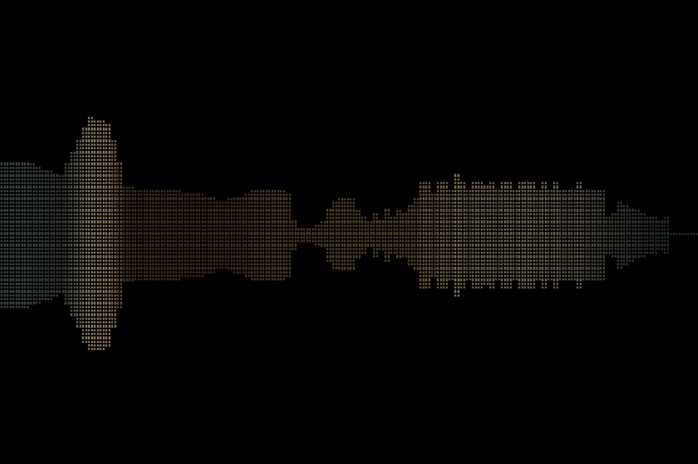

# rava

rava is a terminal audio visualizer for Linux, written in Rust. It draws live
system audio as a mirrored braille spectrum or wide bars, and stays blank while
nothing plays.



Press `w` to switch between the braille spectrum and the wide bars.

## Install

Download the prebuilt Linux binary from
[Releases](https://github.com/karan-rusty/rava/releases/latest):

```sh
curl -L https://github.com/karan-rusty/rava/releases/download/v0.1.0/rava-v0.1.0-x86_64-unknown-linux-gnu.tar.gz | tar xz
```

Or build from source:

```sh
cargo install --git https://github.com/karan-rusty/rava --locked
```

Building needs Rust 1.95 or newer. Live audio also needs `parec` (PulseAudio or PipeWire).

Reinstall with `--force` to upgrade; `cargo uninstall rava` removes it.

## Use

```sh
rava                       # live system audio
rava --source NAME         # a specific source
rava --file track.wav      # loop a WAV
rava --demo                # built-in loop
rava --mode bars           # start on the bars
```

`w` switches views. `q`, `Esc` or `Ctrl+C` quits.

## Configure

```sh
rava --config assets/config.toml
```

Every key is optional, and `assets/config.toml` documents them all.

## Credits

The spectrum is inspired by [NoctaVox](https://github.com/Jaxx497/NoctaVox) (MIT);
rava's implementation is its own. rava is MIT licensed.

AI coding agents (OpenCode) helped with the spectrum and other features, and
rewrote parts of the renderer to fix bugs I could not solve.
