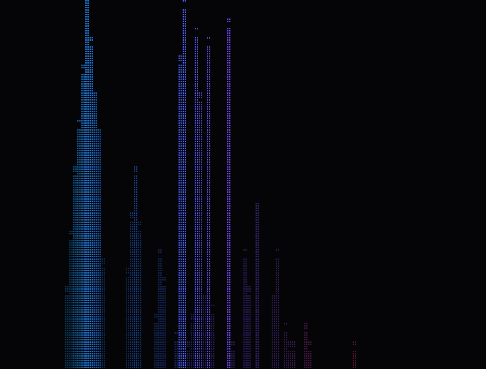

# rava — a CAVA-style terminal audio visualizer

A terminal audio visualizer for Linux written in Rust. By default it listens to
the default PulseAudio/PipeWire output and stays blank while the machine is
silent, waking up as soon as an application starts playing. The spectrum is a
port of the one in [NoctaVox](https://github.com/Jaxx497/NoctaVox); the
original bar renderer is still available too.

## Run

```sh
cargo run --release                       # live system audio
cargo run --release -- --source NAME      # a specific monitor/source
cargo run --release -- --file track.wav   # loop a WAV instead
cargo run --release -- --demo             # built-in synthetic loop
cargo run --release -- --mode bars
cargo run --release -- --config assets/config.toml
```

Live capture needs `parec`, which ships with PulseAudio
(`pulseaudio-utils`) and with PipeWire's PulseAudio compatibility layer.
`--source` takes a source name from `pactl list short sources`; sources ending
in `.monitor` carry what an output device is playing. The default, `auto`, uses
the monitor of the default sink. rava never plays audio itself; it only reads
the mix.

`--file` decodes a WAV (any sample rate, mono or stereo) and loops it. `--demo`
synthesizes a short beat loop. Neither applies the silence gate: they always
draw.

## Silence

With live input the screen starts blank. The first audible chunk wakes it
immediately, and it goes blank again once the input has been quieter than
`-60 dBFS` RMS for one second. Both values live in `[input]`; set
`idle_after_ms = 0` to blank on the first silent chunk, or lower
`threshold_db` if very quiet audio should count as playing. Nothing is drawn
while idle, so a blank screen with the terminal still captured is expected;
`q` or `Esc` quits.

Keys:

| Key | Action |
|---|---|
| `w` | switch between the spectrum and the bars |
| `q`, `Esc` | quit |

## Visualizers

### `spectrum` (default)

Adapted from NoctaVox: a 4096-point Hann-windowed FFT over the last mono
samples, folded into roughly 110 bands from 20 Hz to 20 kHz. (NoctaVox uses
2048 points; doubling the window keeps the bass bands distinct.) Columns are
placed on a logarithmic frequency axis, so 1 kHz sits 57% of the way across
rather than wherever its band happens to fall, and each column shows the
tallest band in its slice. Each frame is normalized against its loudest band, so
a tone stays a narrow spike instead of every band flattening to full height; bars
fall by the exponential decay factor once the energy drops. Values below 5% are
hidden, like NoctaVox's canvas. Color comes from a horizontal gradient that dims
toward black as the band gets quieter. Optional: `mirror = true` grows the bars
above and below the center line, and `speed` scrolls the gradient.



### `bars`

Wide eighth-block bars, one per band, with a vertical gradient over the bar
height. Layout is controlled by `[general]` (`bars`, `bar_width`,
`bar_spacing`, `channel_mode`, `orientation`).

Both views use the same audio and `[output]` colors; `w` switches instantly.

## Configuration

Every key is optional; an empty file gives the built-in look. Unknown keys and
unknown enum values are errors.

```toml
[input]
# "auto" monitors the default sink; otherwise a source name from
# `pactl list short sources`. Use a `.monitor` source to visualize output.
source = "auto"
# Input quieter than this RMS level (dBFS) counts as silence.
threshold_db = -60.0
# Milliseconds of silence before the screen blanks; 0 blanks immediately.
idle_after_ms = 1000

[general]
# Visualizer to start with: "spectrum" or "bars" (`w` toggles at runtime).
mode = "spectrum"
# Bars only: 0 means "as many as fit".
bars = 0
bar_width = 2
bar_spacing = 0
# "average", "split", or "mirror".
channel_mode = "average"

[output]
orientation = "vertical"        # or "horizontal" (bars only)
color_mode = "gradient"         # or "solid" to use `color`
color = "#00e5ff"
gradient = ["#00e5ff", "#2979ff", "#7c4dff", "#ff4081"]

[spectrum]
mirror = false
# How fast bars fall after a peak (0.7–0.97; higher is slower).
decay = 0.85
# Gradient scroll in cycles per second; 0 keeps it still.
speed = 0.0
```

`assets/config.toml` contains the same values with comments.

## Credits

The spectrum analyser and braille rendering are adapted from
[NoctaVox](https://github.com/Jaxx497/NoctaVox) by Jaxx497 (MIT). See
[THIRD_PARTY_NOTICES.md](THIRD_PARTY_NOTICES.md).
